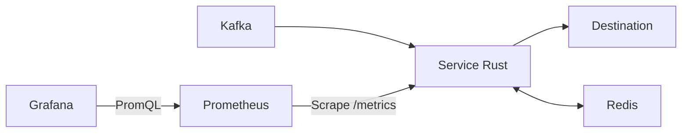
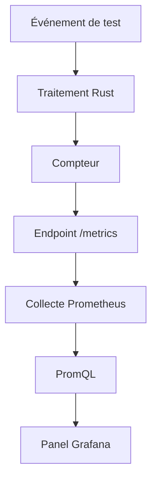

# 018 — Observabilité : démarche corrigée en 22 étapes

Ce document complète et affine le guide 017. Il constitue l'ordre de travail recommandé. Les exemples sont fictifs et génériques. Conserver les données internes exclusivement dans les espaces autorisés.

## Phase 1 — Comprendre

### 01. Analyser le ticket

Lire description, commentaires, tickets associés et merge requests. Identifier les besoins : messages entrants et sortants, réutilisation et uniformisation des métriques, rejets, objets métier traités, comparaison des API. Distinguer exigences et améliorations facultatives. Clarifier les critères d'acceptation avec l'équipe.

Livrable : matrice besoin, service concerné, critère, preuve attendue.

### 02. Cartographier les services

Identifier les quatre dépôts, les responsabilités, les flux Kafka, les interactions Redis, les API, les entrées, sorties, erreurs et retries. Confirmer la topologie avec le code et les configurations.



Ce schéma est illustratif, non une description de l'architecture réelle.

Livrable : schéma des flux vérifiés.

### 03. Vérifier l'environnement

Sur Fedora, depuis le répertoire Compose approprié :

```bash
podman ps -a
podman compose ps
podman network ls
podman ps --format "{{.Names}} {{.Image}} {{.Ports}}"
podman logs --tail 100 prometheus
podman logs --tail 100 grafana
curl -fsS http://localhost:9090/-/ready
curl -fsS http://localhost:3000/api/health
podman exec redis redis-cli PING
```

Adapter noms, ports, authentification et réseau. Vérifier Kafka avec les outils disponibles dans son image. Consulter Prometheus /targets et Grafana Explore. Podman peut rester sur l'hôte Fedora lorsque Distrobox ne peut pas accéder au moteur.

Livrable : environnement identifié, anomalies initiales documentées.

### 04. Auditer les dépôts Rust

```bash
cd ~/workspace/repositories/service-a
git status --short
git branch --show-current
git rev-parse HEAD
git log -10 --oneline
cargo tree --depth 1
rg -n 'prometheus|metrics|counter|histogram|gauge' .
rg -n 'kafka|consumer|producer|redis|reject|track' src
opencode
```

Prompt OpenCode :

> Analyse ce dépôt en lecture seule. Identifie les points d'entrée, flux, consumers, producers, appels Redis, traitements, rejets et métriques. Pour chaque constat indique fichier, fonction, ligne et SHA de référence. Distingue faits et hypothèses. Ne modifie aucun fichier et ne réalise aucun commit.

Livrable : quatre audits et une synthèse.

### 05. Inventorier les métriques et dashboards

```bash
curl -fsS http://localhost:9090/api/v1/label/__name__/values
curl -fsS http://localhost:9090/api/v1/targets
```

Pour chaque métrique relever nom, type, unité, labels, emplacement, événement, exposition, collecte et utilisation dans Grafana. Une métrique déclarée peut être absente du runtime. Les noms historiques dans Prometheus ne prouvent pas une collecte actuelle.

Livrable : inventaire Rust / Prometheus / Grafana.

### 06. Établir la baseline

```bash
git rev-parse HEAD
cargo test --locked
mkdir -p ~/workspace/observability/baseline
curl -fsS http://localhost:9091/metrics > ~/workspace/observability/baseline/service-a.txt
```

Conserver versions, résultats de tests, configuration, captures de métriques, exports JSON des dashboards et mesures disponibles. Documenter les conditions de mesure. Ne pas écraser les modifications locales.

Livrable : état initial reproductible.

## Phase 2 — Concevoir

### 07. Identifier les écarts

Comparer les exigences avec les métriques existantes. Classer chaque couple service/métrique : compatible, à adapter, manquante, non applicable ou non vérifiée. Ne pas ajouter de compteurs aux services sans responsabilité correspondante.

Livrable : liste minimale des modifications par dépôt.

### 08. Valider le contrat commun

| Métrique illustrative | Type | Événement |
|---|---|---|
| messages_received_total | Counter | Message remis au traitement |
| messages_sent_total | Counter | Publication confirmée |
| packets_received_total | Counter | Paquet soumis à validation |
| packets_rejected_total | Counter | Rejet définitif |
| objects_processed_total | Counter | Objet traité avec succès |
| processing_duration_seconds | Histogram | Durée de traitement |
| http_requests_total | Counter | Requête terminée |
| http_request_duration_seconds | Histogram | Durée HTTP |

Privilégier les conventions existantes. Définir unités, labels bornés, points d'incrémentation, retries, doublons, batches, erreurs et resets. Un batch de dix objets peut compter comme un message et dix objets. Ne jamais utiliser les identifiants uniques comme labels. Choisir des buckets compatibles entre architectures. Faire valider le contrat par l'équipe avant implémentation.

Livrable : metrics-contract.md approuvé.

### 09. Préparer les tests et le protocole comparatif

| Scénario indépendant | Delta attendu |
|---|---|
| 100 messages reçus | received +100 |
| 80 publications confirmées | sent +80 |
| 20 paquets rejetés | rejected +20 |
| Batch de 10 objets réussis | objects +10 |
| Publication échouée | sent +0 |

Tester également retries, concurrence, doublons, absence de trafic et redémarrage. Définir pour la comparaison API les charges, données, ressources, replicas, durée, échauffement, répétitions et critères de succès. Utiliser des données synthétiques et un environnement autorisé.

Livrable : plan de tests et protocole approuvés.

## Phase 3 — Valider un premier service

### 10. Instrumenter

Choisir un service représentatif disposant idéalement d'un exporter. Créer une branche selon les conventions du projet.

```bash
git switch -c feature/observability
```

Prompt OpenCode :

> Implémente uniquement les métriques manquantes du contrat validé. Réutilise les bibliothèques existantes. Préserve le comportement métier. Ajoute les tests. Justifie chaque modification. Ne réalise aucun commit.

Exemples avec une version compatible de metrics et un recorder installé :

```rust
metrics::counter!("messages_received_total").increment(1);
metrics::counter!("packets_rejected_total", "reason" => "invalid_format").increment(1);
```

```rust
let start = std::time::Instant::now();
let result = process_message(&message).await;
metrics::histogram!("processing_duration_seconds")
    .record(start.elapsed().as_secs_f64());
result?;
```

Le dernier exemple couvre les retours normaux et erreurs, pas les annulations ou paniques. Confirmer les publications Kafka avant de compter les envois.

Livrable : premier service instrumenté.

### 11. Exécuter les tests

```bash
git diff --stat
git diff
cargo fmt --all -- --check
cargo check --locked
cargo clippy --locked --all-targets
cargo test --locked
cargo build --locked
```

Adapter features et workspace au CI. Isoler les recorders de test. Vérifier les deltas et le comportement métier avec Kafka et Redis.

Livrable : résultats unitaires et intégration.

### 12. Vérifier /metrics

```bash
podman compose up -d --build service-a
podman logs --tail 100 service-a
curl -fsS http://localhost:9091/metrics
```

Capturer les valeurs avant et après injection de données de test. Vérifier types, labels et deltas. Adapter la procédure au projet.

Livrable : preuve d'exposition correcte.

### 13. Vérifier Prometheus

Consulter /targets et les erreurs de scrape. Vérifier DNS, ports, chemin, réseau et authentification. En Kubernetes, contrôler les selectors, ServiceMonitor/PodMonitor si disponibles et la configuration GitOps.

```promql
up{service="service-a"}
messages_received_total{service="service-a"}
```

Le label service est illustratif. UP prouve la réussite du scrape, pas le fonctionnement métier.

Livrable : preuve de collecte.

### 14. Valider PromQL

Débits :

```promql
sum by (service) (rate(messages_received_total[5m]))
sum by (service) (rate(messages_sent_total[5m]))
```

Rejets et objets :

```promql
sum by (service) (increase(packets_rejected_total[1h]))
sum by (service) (rate(objects_processed_total[5m]))
```

Taux de rejet avec dénominateur positif :

```promql
100 * sum by (service) (rate(packets_rejected_total[5m]))
/ (sum by (service) (rate(packets_received_total[5m])) > 0)
```

P95 pour histogrammes classiques :

```promql
histogram_quantile(0.95,
  sum by (service, le) (rate(processing_duration_seconds_bucket[5m]))
)
```

Appliquer rate avant sum. Ne pas moyenner les percentiles. increase extrapole et ne constitue pas un comptage exact. Distinguer absence de données et zéro.

Livrable : catalogue PromQL testé.

### 15. Construire un premier dashboard

Configurer la datasource existante, tester dans Explore, puis créer des panels de disponibilité, débits, rejets et latence selon le périmètre. Vérifier les unités et les plages temporelles. Exporter le JSON.

Jalon obligatoire : démontrer la chaîne complète.



Livrable : preuve de bout en bout avant généralisation.

## Phase 4 — Généraliser

### 16. Étendre aux autres services

Répéter les étapes 10 à 15 pour chaque service concerné. Adapter les points d'instrumentation à ses responsabilités. Ne pas copier aveuglément les métriques.

Livrable : couverture complète du périmètre.

### 17. Harmoniser les dashboards

Proposer trois dashboards : Services Overview, Business Processing et API Comparison. Réutiliser les dashboards existants si possible. Paramétrer les variables service et architecture, les unités et les UID.

```promql
sum by (service) (
  rate(messages_received_total{service=~"$service"}[$__rate_interval])
)
```

Exporter et tester l'import des JSON. Vérifier la compatibilité des métriques et buckets entre services.

Livrable : dashboards homogènes et versionnés.

### 18. Tester la non-régression

Comparer à la baseline : compilation, tests, flux Kafka, Redis, résultats métier, CPU, mémoire, cardinalité, resets et comportement sous charge. Documenter les écarts et seuils acceptés par l'équipe.

Livrable : rapport de non-régression.

### 19. Comparer les architectures API

Mesurer débit réussi, erreurs, P50/P95/P99, CPU, mémoire et replicas. Exécuter des charges identiques avec ressources documentées, échauffement et répétitions. Comparer à ressources égales, puis mesurer l'effet de l'augmentation des replicas.

```promql
sum by (architecture) (rate(http_requests_total[5m]))
histogram_quantile(0.95,
  sum by (architecture, le) (rate(http_request_duration_seconds_bucket[5m]))
)
```

Une architecture plus rapide n'est pas nécessairement plus scalable. Ne pas inventer de résultats. Documenter les limites et les conditions de saturation.

Livrable : rapport comparatif reproductible.

## Phase 5 — Livrer

### 20. Recette

- [ ] Entrants et sortants correctement comptés.
- [ ] Métriques existantes réutilisées et uniformisées.
- [ ] Rejets correctement mesurés.
- [ ] Objets traités correctement comptés dans les services concernés.
- [ ] Collecte Prometheus vérifiée.
- [ ] Dashboards Grafana opérationnels.
- [ ] Comparaison API réalisée selon le protocole.
- [ ] Non-régression démontrée.

Associer à chaque case une preuve et un critère du ticket. Ajouter des alertes uniquement si le périmètre le demande.

### 21. Finaliser la documentation

Documenter progressivement, et non seulement en fin de projet.

```text
observability/
  README.md
  doc/
    001-requirements.md
    002-architecture.md
    003-environment.md
    004-services-audit.md
    005-metrics-inventory.md
    006-baseline.md
    007-metrics-contract.md
    008-test-plan.md
    009-implementation.md
    010-prometheus.md
    011-promql.md
    012-grafana.md
    013-api-comparison.md
    014-validation.md
  grafana/
    dashboards/
      services-overview.json
      business-processing.json
      api-comparison.json
```

Respecter l'organisation existante et les règles de confidentialité.

### 22. Soumettre les modifications GitLab

Prompt OpenCode :

> Relis le diff par rapport au ticket et au contrat. Recherche doubles comptages, erreurs de concurrence, cardinalité, labels, régressions et tests manquants. Vérifie la cohérence Rust, Prometheus, PromQL et Grafana. Classe les anomalies par gravité. Ne modifie rien et ne réalise aucun commit.

Relire les changements, préparer les merge requests et coordonner les dépendances entre dépôts applicatifs, infrastructure et dashboards. Prévoir l'ordre de déploiement et le retour arrière. Soumettre à la revue humaine.

## Synthèse

| Jalon | Condition de passage |
|---|---|
| J01 Compréhension | Existant et baseline documentés |
| J02 Conception | Contrat et tests validés |
| J03 Expérimentation | Un service validé jusqu'à Grafana |
| J04 Généralisation | Couverture et comparaison vérifiées |
| J05 Livraison | Recette et merge requests prêtes |

Commencer par la phase 1. Ne pas développer avant de comprendre les flux, les métriques et la chaîne de collecte existante.
