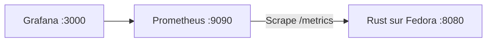

# 019 — Installation locale Rust, Prometheus et Grafana

Objectif : exécuter une application Rust directement sur Fedora et Prometheus/Grafana dans deux conteneurs Podman. Aucun Kafka, Redis ou Kubernetes nécessaire.

## 1. Architecture



## 2. Prérequis

Sur Fedora, hors Distrobox :

```bash
podman --version
cargo --version
rustc --version
curl --version
mkdir -p ~/workspace/observability-local
cd ~/workspace/observability-local
cargo new app
mkdir -p prometheus grafana
```

Les images et dépendances doivent être accessibles via les registres autorisés. Sur un poste d'entreprise, adapter les références aux miroirs internes. Les versions ci-dessous sont des exemples reproductibles, pas une affirmation qu'elles sont les dernières.

## 3. Application Rust

Remplacer app/Cargo.toml :

```toml
[package]
name = "app"
version = "0.1.0"
edition = "2021"

[dependencies]
axum = "0.8"
tokio = { version = "1", features = ["full"] }
prometheus = "0.13"
```

Remplacer app/src/main.rs :

```rust
use axum::{extract::State, http::StatusCode, response::IntoResponse, routing::get, Router};
use prometheus::{Encoder, IntCounter, Registry, TextEncoder};

#[derive(Clone)]
struct AppState {
    registry: Registry,
    received: IntCounter,
    sent: IntCounter,
    rejected: IntCounter,
}

async fn process(State(state): State<AppState>) -> &'static str {
    state.received.inc();
    state.sent.inc();
    "processed"
}

async fn reject(State(state): State<AppState>) -> (StatusCode, &'static str) {
    state.received.inc();
    state.rejected.inc();
    (StatusCode::BAD_REQUEST, "rejected")
}

async fn metrics(State(state): State<AppState>) -> impl IntoResponse {
    let encoder = TextEncoder::new();
    let mut buffer = Vec::new();
    match encoder.encode(&state.registry.gather(), &mut buffer) {
        Ok(()) => (
            StatusCode::OK,
            [(axum::http::header::CONTENT_TYPE, encoder.format_type().to_owned())],
            buffer,
        ),
        Err(_) => (
            StatusCode::INTERNAL_SERVER_ERROR,
            [(axum::http::header::CONTENT_TYPE, "text/plain".to_owned())],
            b"encoding failed".to_vec(),
        ),
    }
}

#[tokio::main]
async fn main() {
    let registry = Registry::new();
    let received = IntCounter::new("messages_received_total", "Received messages").unwrap();
    let sent = IntCounter::new("messages_sent_total", "Sent messages").unwrap();
    let rejected = IntCounter::new("messages_rejected_total", "Rejected messages").unwrap();

    registry.register(Box::new(received.clone())).unwrap();
    registry.register(Box::new(sent.clone())).unwrap();
    registry.register(Box::new(rejected.clone())).unwrap();

    let state = AppState { registry, received, sent, rejected };
    let app = Router::new()
        .route("/process", get(process))
        .route("/reject", get(reject))
        .route("/metrics", get(metrics))
        .with_state(state);

    let listener = tokio::net::TcpListener::bind("127.0.0.1:8080").await.unwrap();
    axum::serve(listener, app).await.unwrap();
}
```

Terminal 1 :

```bash
cd ~/workspace/observability-local/app
cargo fmt
cargo build
cargo run
```

Terminal 2 :

```bash
curl http://127.0.0.1:8080/process
curl http://127.0.0.1:8080/reject
curl http://127.0.0.1:8080/metrics
```

Les compteurs attendus sur une application fraîche sont received=2, sent=1, rejected=1. Les appels /metrics ne modifient pas les compteurs métier.

## 4. Prometheus

Créer prometheus/prometheus.yml :

```yaml
global:
  scrape_interval: 5s

scrape_configs:
  - job_name: rust-local
    static_configs:
      - targets:
          - 127.0.0.1:8080
```

Le réseau host est choisi volontairement pour ce prototype Linux local : Prometheus peut joindre le Rust lié à localhost. Restreindre également son écoute à localhost. Ne pas utiliser cette configuration telle quelle en production.

```bash
cd ~/workspace/observability-local
podman volume create obs-prometheus
podman run -d --name obs-prometheus \
  --network host \
  -v "$PWD/prometheus/prometheus.yml:/etc/prometheus/prometheus.yml:ro,Z" \
  -v obs-prometheus:/prometheus \
  docker.io/prom/prometheus:v3.5.0 \
  --config.file=/etc/prometheus/prometheus.yml \
  --storage.tsdb.path=/prometheus \
  --web.listen-address=127.0.0.1:9090
```

```bash
podman logs obs-prometheus
curl -fsS http://127.0.0.1:9090/-/ready
```

Ouvrir http://127.0.0.1:9090/targets et vérifier rust-local UP.

## 5. Grafana

Créer grafana/datasource.yml :

```yaml
apiVersion: 1
datasources:
  - name: Prometheus
    uid: prometheus-local
    type: prometheus
    access: proxy
    url: http://127.0.0.1:9090
    isDefault: true
    editable: true
```

```bash
podman volume create obs-grafana
podman run -d --name obs-grafana \
  --network host \
  -e GF_SERVER_HTTP_ADDR=127.0.0.1 \
  -v obs-grafana:/var/lib/grafana \
  -v "$PWD/grafana/datasource.yml:/etc/grafana/provisioning/datasources/local.yml:ro,Z" \
  docker.io/grafana/grafana:12.1.0
```

```bash
podman logs obs-grafana
curl -fsS http://127.0.0.1:3000/api/health
```

Ouvrir http://127.0.0.1:3000. Sur une installation neuve, connexion admin/admin, puis modifier le mot de passe. La datasource Prometheus est provisionnée automatiquement.

## 6. Générer du trafic

Terminal 3 :

```bash
while true; do
  for i in $(seq 1 9); do
    curl -fsS http://127.0.0.1:8080/process >/dev/null
  done
  curl -sS http://127.0.0.1:8080/reject >/dev/null
  sleep 1
done
```

Arrêter avec Ctrl+C. Le taux de rejet attendu est proche de 10 % pendant le trafic stable.

## 7. Tester PromQL

Dans Prometheus ou Grafana Explore :

```promql
up{job="rust-local"}
messages_received_total
messages_sent_total
messages_rejected_total
rate(messages_received_total[1m])
rate(messages_sent_total[1m])
rate(messages_rejected_total[1m])
100 * rate(messages_rejected_total[1m])
/ (rate(messages_received_total[1m]) > 0)
```

Attendre plusieurs scrapes pour calculer les rates. Les compteurs repartent à zéro au redémarrage de Rust.

## 8. Premier dashboard Grafana

Dashboards > New > New dashboard > Add visualization > Prometheus.

| Panel | Requête | Visualisation |
|---|---|---|
| Disponibilité | up{job="rust-local"} | Stat |
| Entrants | messages_received_total | Stat |
| Sortants | messages_sent_total | Stat |
| Rejets | messages_rejected_total | Stat |
| Débit entrant | rate(messages_received_total[1m]) | Time series |
| Débit sortant | rate(messages_sent_total[1m]) | Time series |
| Taux de rejet | 100 * rate(messages_rejected_total[1m]) / (rate(messages_received_total[1m]) > 0) | Time series |

Choisir une plage de 5 minutes, rafraîchissement 5 secondes, unité percent (0-100) pour le taux. Sauvegarder et exporter le JSON.

## 9. Exploitation et dépannage

```bash
podman ps -a
podman logs --tail 100 obs-prometheus
podman logs --tail 100 obs-grafana
ss -ltn
curl -fsS http://127.0.0.1:8080/metrics
curl -fsS http://127.0.0.1:9090/api/v1/targets
```

Si un port est occupé, adapter le port et toutes les références associées. Si une image est inaccessible, utiliser le registre interne autorisé. Ne pas désactiver SELinux : le suffixe Z adapte le label des fichiers montés. Si les volumes ne sont pas accessibles, examiner les permissions et le mapping rootless. Ne pas exécuter le prototype en root pour contourner un problème.

Arrêt :

```bash
podman stop obs-grafana obs-prometheus
```

Redémarrage :

```bash
podman start obs-prometheus obs-grafana
```

Suppression des conteneurs, sans effacer les données :

```bash
podman rm -f obs-grafana obs-prometheus
```

Les volumes persistent. Leur suppression effacerait les données et dashboards stockés.

## 10. Validation

- [ ] Rust répond sur 8080.
- [ ] /metrics expose les trois compteurs.
- [ ] Prometheus répond sur 9090.
- [ ] La cible rust-local est UP.
- [ ] Grafana répond sur 3000.
- [ ] La datasource fonctionne.
- [ ] Le trafic apparaît dans les panels.
- [ ] Le taux de rejet est proche de 10 %.

Ce prototype isole la chaîne d'observabilité avant de travailler sur les services réels. Les commandes et le code sont proposés pour exécution locale, non testés sur le poste cible.
