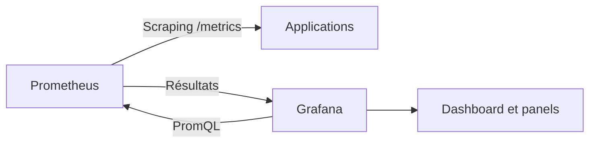
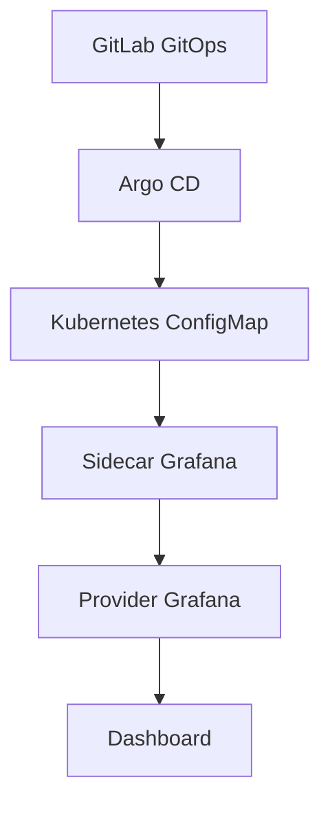

# 021 — Grafana, Kubernetes et GitOps

Environnement pédagogique fictif Ganatan. Aucun accès réel ni déploiement n'est effectué dans ce guide.

## 1. Qu'est-ce que Grafana ?

Grafana est un outil open source de visualisation et de supervision. Il construit des dashboards à partir de sources de données telles que Prometheus pour surveiller applications et infrastructures.

## 2. Historique et créateur

Grafana a été créé par Torkel Ödegaard, avec un premier lancement public en 2014, à partir d'un fork de Kibana. Le projet est aujourd'hui principalement développé par Grafana Labs et sa communauté.

## 3. Deux modes de gestion des dashboards

- Interface graphique : création, modification, import et export JSON.
- Kubernetes : provisioning automatisé des dashboards via ConfigMaps, généralement dans une démarche GitOps.

## 4. Environnement réseau Ganatan

Trois nœuds Kubernetes et trois VIP exposent les services via des Ingress. Les adresses et noms suivants sont fictifs.

| Équipement | IP | Fonction |
|---|---|---|
| ganatan-node-01 | 192.168.10.11 | Nœud Kubernetes |
| ganatan-node-02 | 192.168.10.12 | Nœud Kubernetes |
| ganatan-node-03 | 192.168.10.13 | Nœud Kubernetes |
| ganatan-vip-01 | 192.168.10.101 | Grafana |
| ganatan-vip-02 | 192.168.10.102 | Prometheus |
| ganatan-vip-03 | 192.168.10.103 | Argo CD |

## 5. Connexion SSH au cluster

SSH permet d'accéder aux nœuds autorisés. L'utilisation de kubectl nécessite également un kubeconfig et des droits RBAC adaptés.

```bash
ssh ganatan@192.168.10.11
ssh ganatan@192.168.10.12
ssh ganatan@192.168.10.13
```

## 6. Accès aux VIP via tunnel SSH

Le tunnel redirige les ports locaux vers les VIP HTTPS accessibles depuis le nœud SSH. Il reste actif tant que la connexion est ouverte.

```bash
ssh -N -o ExitOnForwardFailure=yes \
  -L 127.0.0.1:8443:192.168.10.101:443 \
  -L 127.0.0.1:8444:192.168.10.102:443 \
  -L 127.0.0.1:8445:192.168.10.103:443 \
  ganatan@192.168.10.11
```

| Service | Port local | URL si Ingress par nom |
|---|---|---|
| Grafana | 8443 | https://grafana.ganatan.test:8443 |
| Prometheus | 8444 | https://prometheus.ganatan.test:8444 |
| Argo CD | 8445 | https://argocd.ganatan.test:8445 |

Si les Ingress utilisent ces noms fictifs, les faire résoudre localement vers 127.0.0.1 et utiliser des certificats TLS approuvés correspondant aux noms. Les URL localhost ne conviennent que si le routage et les certificats le permettent. Ne pas désactiver la vérification TLS.

## 7. Dashboards et source de données Prometheus

Prometheus collecte les métriques exposées par les applications sur /metrics. Grafana interroge Prometheus avec PromQL et affiche les résultats dans des panels (courbes, tableaux, compteurs, jauges).



## 8. Format JSON des dashboards

Un dashboard JSON contient son UID, son titre, ses panels, leurs sources de données et leurs requêtes. Ce format permet de versionner les dashboards dans Git.

Fichier ganatan-dashboard.json :

```json
{
  "uid": "ganatan-monitoring",
  "title": "Ganatan Monitoring",
  "schemaVersion": 39,
  "version": 1,
  "refresh": "10s",
  "panels": [
    {
      "id": 1,
      "title": "Messages reçus par seconde",
      "type": "timeseries",
      "datasource": {
        "type": "prometheus",
        "uid": "prometheus"
      },
      "targets": [
        {
          "refId": "A",
          "expr": "rate(messages_received_total[5m])"
        }
      ],
      "gridPos": {
        "h": 8,
        "w": 24,
        "x": 0,
        "y": 0
      }
    }
  ]
}
```

| Propriété | Description |
|---|---|
| uid | Identifiant du dashboard |
| title | Titre |
| refresh | Fréquence de rafraîchissement |
| panels | Composants graphiques |
| datasource | Source Prometheus |
| targets | Requêtes PromQL |
| gridPos | Position et dimensions |

La métrique messages_received_total est fictive. L'UID prometheus et la version du schéma doivent correspondre à l'installation.

## 9. Import via l'interface Grafana

1. Se connecter à Grafana.
2. Ouvrir Dashboards → New → Import.
3. Charger ganatan-dashboard.json.
4. Vérifier ou sélectionner la source Prometheus si proposée.
5. Cliquer sur Import.
6. Vérifier le panel et les résultats PromQL.

Effectuer cet essai dans un environnement autorisé, avec un UID distinct si le dashboard est déjà géré par provisioning.

## 10. Création dans Kubernetes via ConfigMap

Le JSON est intégré dans une ConfigMap. Un sidecar configuré pour surveiller les ConfigMaps portant le label attendu écrit le JSON dans un répertoire lu par le provider Grafana.

Fichier ganatan-dashboard.yaml :

```yaml
apiVersion: v1
kind: ConfigMap
metadata:
  name: ganatan-dashboard
  namespace: monitoring
  labels:
    grafana_dashboard: "1"
data:
  ganatan-dashboard.json: |
    {
      "uid": "ganatan-monitoring",
      "title": "Ganatan Monitoring",
      "schemaVersion": 39,
      "version": 1,
      "refresh": "10s",
      "panels": [
        {
          "id": 1,
          "title": "Messages reçus par seconde",
          "type": "timeseries",
          "datasource": {
            "type": "prometheus",
            "uid": "prometheus"
          },
          "targets": [
            {
              "refId": "A",
              "expr": "rate(messages_received_total[5m])"
            }
          ],
          "gridPos": {
            "h": 8,
            "w": 24,
            "x": 0,
            "y": 0
          }
        }
      ]
    }
```

Le namespace monitoring, le label grafana_dashboard et sa valeur sont des conventions fictives à adapter à la configuration du sidecar et du provider.

## 11. Cas pratique Kubernetes et K9s

### 11.1. Connexion et contrôle du contexte

```bash
ssh ganatan@192.168.10.11
kubectl config current-context
kubectl get nodes
kubectl get namespaces
kubectl get pods -n monitoring
```

### 11.2. Déploiement manuel pédagogique

Uniquement dans un environnement de test autorisé non géré par GitOps, avec le fichier YAML disponible sur le poste exécutant kubectl.

```bash
kubectl apply -f ganatan-dashboard.yaml
```

### 11.3. Vérification avec kubectl

```bash
kubectl get configmaps -n monitoring
kubectl describe configmap ganatan-dashboard -n monitoring
kubectl get pods -n monitoring
kubectl get configmap ganatan-dashboard -n monitoring -o json | jq -e '.data["ganatan-dashboard.json"] | fromjson'
```

### 11.4. Vérification avec K9s

K9s est une interface terminal permettant de naviguer dans les ressources Kubernetes et de consulter leur contenu et leurs logs.

```bash
k9s -n monitoring --readonly
```

| Commande | Fonction |
|---|---|
| :ns | Namespaces |
| :cm | ConfigMaps |
| :pods | Pods |
| :svc | Services |
| :ing | Ingress |
| /grafana | Filtrer |
| d | Décrire la ressource |
| y | Afficher le YAML |
| l | Logs du pod ou du conteneur sélectionné |

### 11.5. Validation dans Grafana

Ouvrir Grafana via le tunnel SSH, rechercher Ganatan Monitoring et vérifier le panel. La présence de la ConfigMap ne prouve pas que Grafana a chargé le dashboard.

## 12. Cas pratique GitLab et GitOps

GitLab contient les manifestes Kubernetes. Argo CD synchronise la révision Git avec le cluster, puis le provisioning Grafana charge les dashboards.

### 12.1. Structure fictive du dépôt

```text
gitops/
├── monitoring/
│   ├── grafana/
│   │   ├── dashboards/
│   │   │   ├── ganatan-dashboard.yaml
│   │   │   ├── kafka-dashboard.yaml
│   │   │   └── redis-dashboard.yaml
│   │   └── kustomization.yaml
│   └── prometheus/
└── README.md
```

### 12.2. Cloner et créer une branche

```bash
git clone git@gitlab.ganatan.local:ganatan/gitops.git
cd gitops
git checkout -b feature/grafana-dashboard
```

### 12.3. Ajouter la ConfigMap

Placer le YAML de la section 10 dans monitoring/grafana/dashboards/ et ajouter sa référence au kustomization.yaml existant sans supprimer les autres ressources.

```yaml
apiVersion: kustomize.config.k8s.io/v1beta1
kind: Kustomization
resources:
  - dashboards/ganatan-dashboard.yaml
  - dashboards/kafka-dashboard.yaml
  - dashboards/redis-dashboard.yaml
```

### 12.4. Valider avant publication

```bash
kubectl kustomize monitoring/grafana
git diff --check
git status
```

Kustomize vérifie la génération des manifestes, mais pas la validité fonctionnelle du JSON Grafana ni des requêtes PromQL.

### 12.5. Publier sur GitLab

```bash
git add monitoring/grafana/dashboards/ganatan-dashboard.yaml monitoring/grafana/kustomization.yaml
git commit -m "feat: add Grafana dashboard"
git push -u origin feature/grafana-dashboard
```

Créer une Merge Request, obtenir sa validation et fusionner dans la branche surveillée par Argo CD.

### 12.6. Déploiement GitOps



Argo CD applique les ressources automatiquement si l'auto-sync est activé, sinon une synchronisation autorisée est nécessaire. Un fichier .gitlab-ci.yml n'est pas indispensable à cette synchronisation.

### 12.7. Vérification du déploiement

| Outil | Contrôle |
|---|---|
| GitLab | Merge Request fusionnée et commit attendu |
| Argo CD | Révision attendue, Synced et Healthy |
| kubectl | ConfigMap présente et JSON correct |
| K9s | Contenu et logs du sidecar |
| Grafana | Dashboard et panels chargés |
| Prometheus | Requêtes PromQL et métriques disponibles |

En GitOps, Git est la source de vérité : ne pas appliquer manuellement les ConfigMaps sur l'environnement cible. Les vérifications en production restent en lecture seule.

## 13. Prérequis et limites

Ce guide suppose un cluster existant, des accès autorisés, des Ingress HTTPS, un sidecar et un provider Grafana configurés, une source Prometheus et une application Argo CD surveillant le dépôt. Kustomize est un choix pédagogique ; adapter à Helm ou aux manifestes bruts si nécessaire. Les exemples n'ont pas été exécutés sur un cluster réel.

Pour approfondir la validation du déploiement sans infrastructure locale : [020 — Validation GitOps Grafana](020-gitops-grafana-validation-deploiement.md).
